<div align="center">


# Traffic Target

**A Windows app that tells you exactly how fast you need to move data to hit today's GB target and this year's TB target, using your real network traffic.**

[](https://github.com/Fahim-Iftekhar/traffic-target/actions/workflows/build.yml)
[](https://github.com/Fahim-Iftekhar/traffic-target/releases/latest)


[](LICENSE)

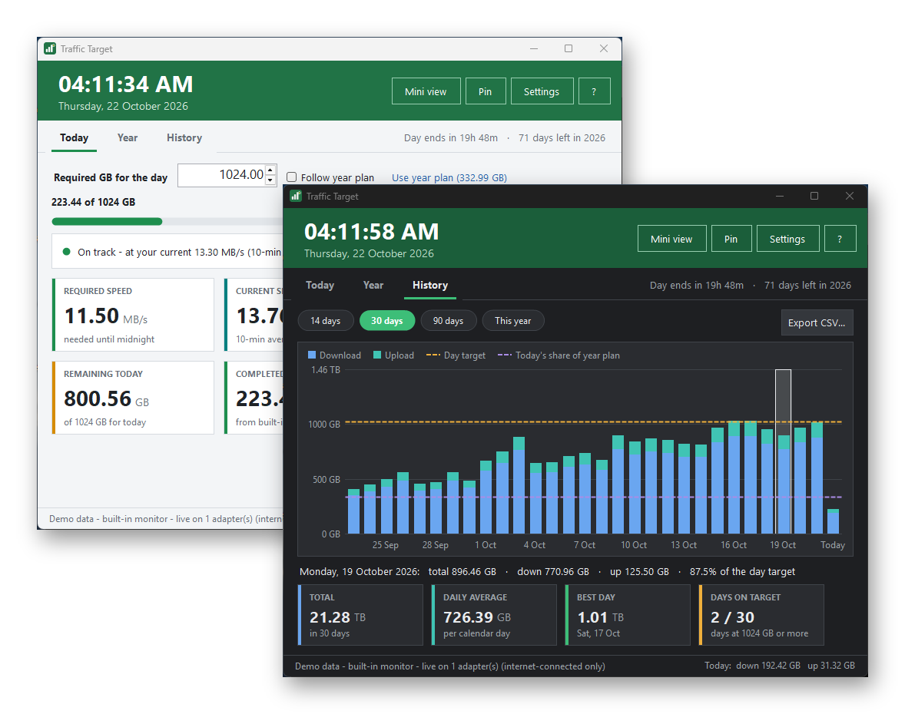

</div>

---

## Why

Traffic Target started life as an Excel workbook with two sheets: a **Day** sheet (how many MB/s do I need until midnight to finish today's GB?) and a **Year** sheet (how many GB per day and per week do I need to finish this year's TB target?). Updating it by hand meant typing the completed traffic and the time left, over and over.

Traffic Target does the same maths automatically. **You type two numbers: the GB target for the day and the TB target for the year.** The date and time come from Windows, and the completed traffic comes from your network adapters (or from [TrafficMonitor](https://github.com/zhongyang219/TrafficMonitor), if you use it).

## Features

| | |
|---|---|
| **Live daily target** | Required speed (MB/s) until midnight, GB per minute and per hour, remaining GB and time left, all updated every second. |
| **Forecast** | Uses your 10-minute average speed to say *"On track: you'll finish at 9:18 PM"* or *"Behind: you'll reach 812 GB by midnight (212 GB short)"*. |
| **Yearly target** | GB per day and per week still needed, days left (counted from the Windows date), and a 7-day pace projection to 31 December. |
| **Follow the year plan** | One click sets today's GB target to today's share of the yearly target, or let it follow the plan automatically. |
| **Interactive history** | Stacked download/upload bar chart for 14 / 30 / 90 days or the whole year, with day-target and plan lines, hover tooltips, click-to-select, and totals, averages, best day and days on target. |
| **Two traffic sources** | Reads **TrafficMonitor**'s daily history *plus* live counting between its saves, or uses the **built-in monitor** (a TrafficMonitor-style counter with its own history). Manual entry is also available. |
| **Mini view** | A small always-on-top widget with the required speed, what's left, your live speed and a progress bar. Drag it anywhere. |
| **Tray icon with progress ring** | Shows today's progress at a glance; the tooltip shows the speed you need. |
| **Notifications** | A toast when today's target is reached, and (at most hourly) a warning when your current speed won't make it. |
| **Light and dark themes** | Follows Windows automatically, including the dark title bar, or can be forced to light or dark. |
| **CSV export** | Export the full daily history (download, upload, total, counted). |
| **Lightweight** | A single ~115 KB `.exe` with no installer, no runtime to install, no network access and no telemetry. |

## Screenshots

| Light | Dark |
|---|---|
| 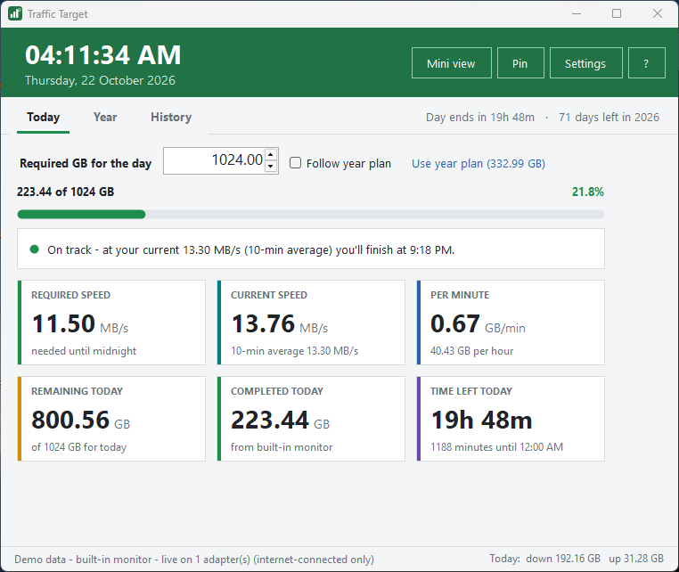 | 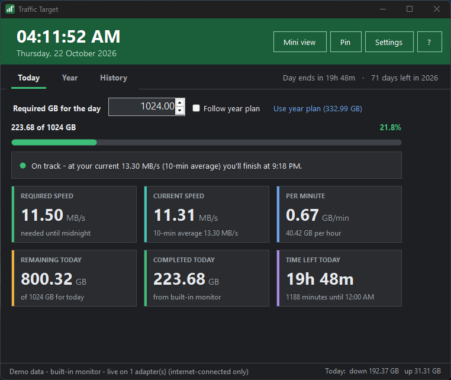 |
| 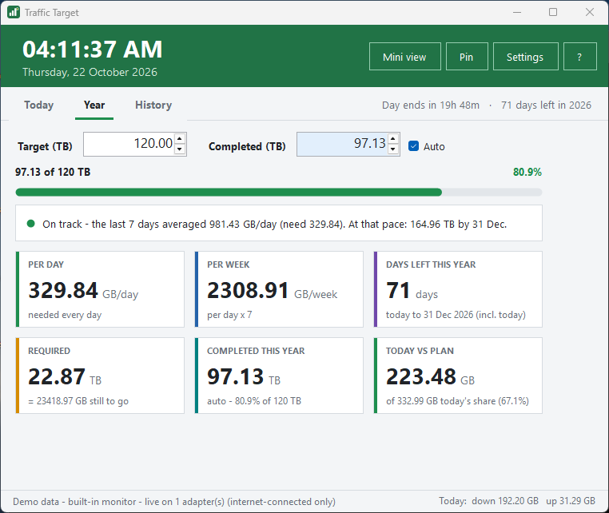 | 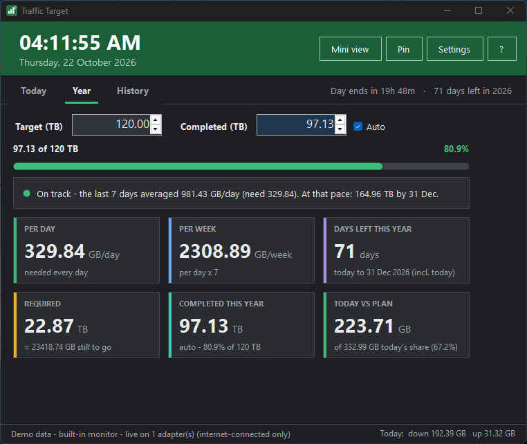 |
| 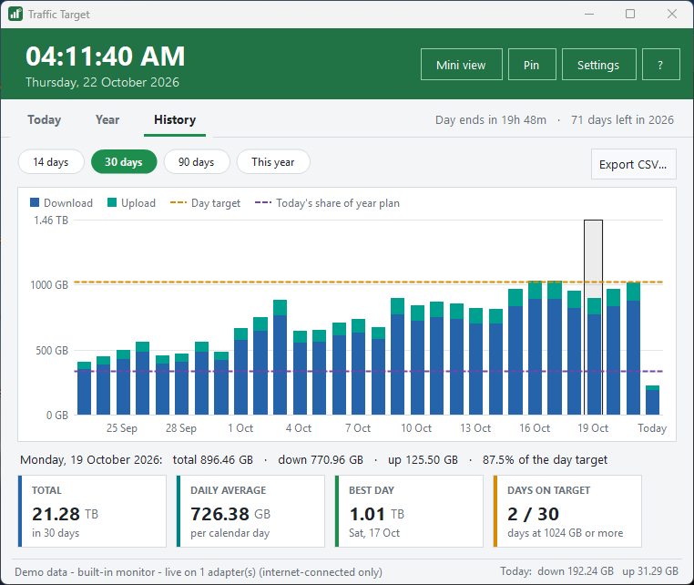 | 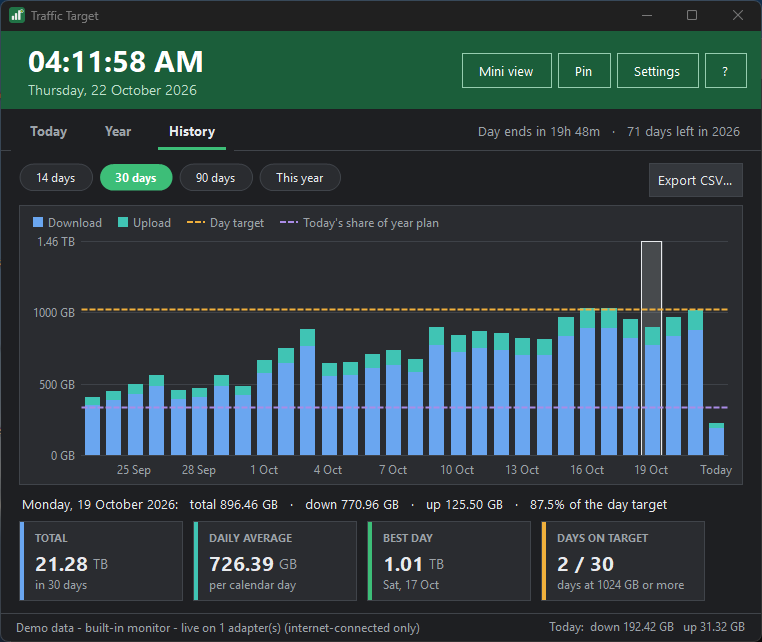 |
| 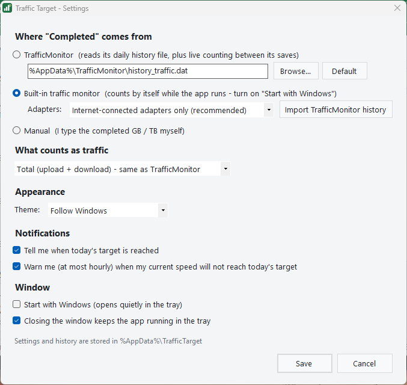 | 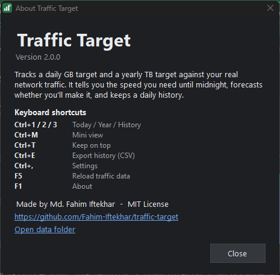 |

Mini view: 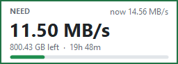 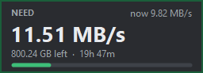

<sub>Screenshots use the built-in demo data (`TrafficTarget.exe /screenshots <folder>`), not real traffic.</sub>

## Download and run

1. Download **`TrafficTarget.exe`** from the [latest release](https://github.com/Fahim-Iftekhar/traffic-target/releases/latest).
2. Put it in any folder (for example `Documents\Traffic Target`) and double-click it.
3. Type your **Required GB for the day** (Today tab) and your **Target (TB)** (Year tab). That's it.

> **Windows SmartScreen:** the executable isn't code-signed, so Windows may show *"Windows protected your PC"* the first time. Click **More info → Run anyway**, or build it yourself from source (below) in about five seconds.

**Requirements:** Windows 10 or 11 (Windows 7 SP1 / 8.1 also work) with .NET Framework 4.x, which is built into Windows 10 and 11.

## Build from source

No Visual Studio and no SDK needed: Windows already includes the C# compiler.

```bat
git clone https://github.com/Fahim-Iftekhar/traffic-target.git
cd traffic-target
build.bat
```

`build.bat` compiles every file under `src\` with `%WINDIR%\Microsoft.NET\Framework64\v4.0.30319\csc.exe`, writes `TrafficTarget.exe` next to it, and starts it. The compiler output goes to `build_log.txt`. The code sticks to C# 5 so that this built-in compiler can build it.

Every push is also built by [GitHub Actions](.github/workflows/build.yml) on `windows-latest`; pushing a `v*` tag publishes a release with the executable attached.

## How it works

### The Day calculation (Excel sheet "Day")

| Cell | Meaning | Formula |
|---|---|---|
| B3 | Required GB for the day | **you enter it** (or follow the year plan) |
| B4 | Completed today (GB) | from the traffic source |
| B5 | Remaining GB | `B3 - B4` |
| C5 | Minutes left today | Windows clock, until 12:00 AM |
| F3 | GB per minute | `B5 / C5` |
| G3 | **Required speed (MB/s)** | `F3 * 1024 / 60` |

### The Year calculation (Excel sheet "Year")

| Cell | Meaning | Formula |
|---|---|---|
| E3 | Target (TB) | **you enter it** |
| F3 | Completed (TB) | this year's total from the traffic history (or typed) |
| G3 | Required (TB) | `E3 - F3` |
| H3 | Required (GB) | `G3 * 1024` |
| C6 | Days left | today → 31 December, today included (Windows date) |
| I3 | **GB per day** | `H3 / C6` |
| J3 | GB per week | `I3 * 7` |

Units follow the original workbook: 1 TB = 1024 GB and 1 GB = 1024 MB.

**Today's share of the year plan** is `(target TB - completed before today) * 1024 / days left`. It's fixed for the whole day, so you can use it as the day target (*Follow year plan*).

### Forecasts

- **Today:** the average speed over the last 10 minutes is projected to midnight. If it finishes the remaining GB in time, the forecast shows the finish time; otherwise it shows how much you'll fall short and the speed you need.
- **Year:** the average of the last 7 complete days is projected over the days left, with today counted as at least that average.

### Where the "completed" traffic comes from

| Source | How it works |
|---|---|
| **TrafficMonitor** *(default when installed)* | Reads `%AppData%\TrafficMonitor\history_traffic.dat` (lines like `2026/10/21 40012802/96306108`, upload/download in KB). Because TrafficMonitor only saves that file now and then, Traffic Target adds its own live count since the last save, so the number moves every second and re-syncs whenever the file is saved. |
| **Built-in monitor** | Samples the byte counters of your network adapters every second (by default only adapters with a default gateway, so Hyper-V/WSL/VMware virtual adapters aren't counted twice) and keeps a daily history in `%AppData%\TrafficTarget\traffic_history.dat`. It only counts while the app runs, so turn on **Start with Windows**. You can import your TrafficMonitor history once. |
| **Manual** | You type today's completed GB and this year's completed TB. |

**What counts as traffic** can be *Total (upload + download)*, matching TrafficMonitor's "Total traffic", *Download only* or *Upload only*.

## Using the app

- **Today / Year / History** tabs (`Ctrl+1/2/3`).
- **Mini view** (`Ctrl+M`): drag to move, double-click to open the main window, right-click for options.
- **Pin** (`Ctrl+T`) keeps the main window on top.
- **Closing the window** keeps Traffic Target running in the tray, so tracking and notifications continue. To quit, right-click the tray icon and choose **Exit**.
- **History:** hover a bar for details, click to pin a day, and use **Export CSV…** (`Ctrl+E`) to save the full history.
- **Settings** (`Ctrl+,`): traffic source, adapters, what counts, theme, notifications, start with Windows, close to tray.
- `F5` reloads the traffic data; `F1` shows About.

### Command line

| Argument | Effect |
|---|---|
| `/tray` | Start hidden in the tray (used by *Start with Windows*). |
| `/screenshots "<folder>"` | Render every view in light and dark mode with demo data, save PNGs to the folder, then exit. Your real settings and history are never touched. `tools\screenshots.bat` regenerates `docs\screenshots`. |

### Files

Everything lives in `%AppData%\TrafficTarget`:

| File | Contents |
|---|---|
| `settings.ini` | Your targets and preferences (plain `key=value`). |
| `traffic_history.dat` | Built-in monitor history: `yyyy/MM/dd upload_bytes/download_bytes`. |
| `error.log` | Written only if something goes wrong. |

Traffic Target makes **no network connections** and collects no data. It only reads your adapters' byte counters and, if you choose, TrafficMonitor's history file.

## Project structure

```
traffic-target/
├─ build.bat                 one-click build with the compiler built into Windows
├─ assets/                   app icon + manifest (DPI-aware, common controls v6)
├─ src/
│  ├─ Program.cs             entry point, single instance, crash log, Win32 helpers
│  ├─ Core/
│  │  ├─ AppSettings.cs      settings.ini load/save, start-with-Windows
│  │  ├─ Plans.cs            DayPlan / YearPlan: the Excel formulas
│  │  └─ Traffic.cs          history files, adapter counter, TrafficEngine (sources, live speed, demo data)
│  └─ UI/
│     ├─ Theme.cs            light/dark palettes, fonts, DPI scaling, formatting
│     ├─ Controls.cs         tiles, tabs, chips, progress bar, forecast line, history chart, tray icon
│     ├─ MainForm.cs         main window, tray, notifications, shortcuts, screenshot mode
│     ├─ MiniForm.cs         always-on-top mini view
│     └─ Dialogs.cs          Settings and About
├─ tools/screenshots.bat     rebuild + regenerate docs/screenshots
└─ .github/workflows/        CI build and tagged releases
```

## FAQ

**The completed GB differs slightly from TrafficMonitor.** Between TrafficMonitor's saves, Traffic Target counts live on all active adapters, while TrafficMonitor may count a specific connection. The value re-syncs whenever TrafficMonitor saves its history.

**The built-in monitor missed traffic.** It only counts while Traffic Target is running. Enable *Start with Windows* (it starts quietly in the tray).

**My day doesn't end at midnight.** For now the day runs from 12:00 AM to 12:00 AM local time, the same as TrafficMonitor's daily history.

## Contributing

Issues and pull requests are welcome. Keep the code compatible with the C# 5 compiler (`build.bat` must succeed on a clean Windows install). No `$""` strings, `?.`, `nameof` or expression-bodied members.

## License

[MIT](LICENSE) © 2026 Md. Fahim Iftekhar
